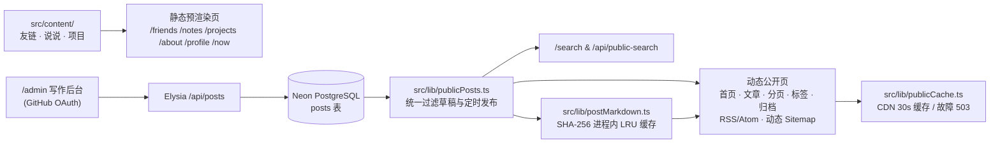

# EtherGray Blog

一个基于 **Astro 7** 构建的个人博客，同时也是面向工程实践的 **TypeScript + 全栈 Astro 学习项目**。

🌐 **正式站点**：[https://ethergray.netlify.app/](https://ethergray.netlify.app/) · **开发预览**：`develop--ethergray.netlify.app`（需团队登录） · **开发约定**：[AGENTS.md](AGENTS.md)

---

## ✨ 核心特性

- **动静结合架构**：友链、说说、项目、关于页等构建时预渲染为静态 HTML；文章阅读、分页、标签、归档、RSS/Atom、动态站点地图与搜索实时查库，配合 Netlify CDN 30 秒短缓存。
- **动态发布，无需重跑部署**：文章存放在 Neon PostgreSQL 的 `posts` 表中，后台保存后约 30 秒内前台自动更新，不再每次消耗 Netlify 生产部署额度。
- **数据库实时搜索**：内置 `/search` 与 `/api/public-search`，支持标题、摘要、正文与标签的参数化实时检索，支持无 JavaScript 降级。
- **无状态 GitHub OAuth 写作后台**：基于 Better Auth 无状态加密 Cookie（JWE）与 `GITHUB_OWNER_ID` 单博主白名单，不建 `users` 表、不存密码，自带加载防误提交与未保存离开提醒。
- **完整的写作排版支持**：Shiki 双主题代码高亮、KaTeX 数学公式、Mermaid 图表、Obsidian 风格提示块、自动目录、图片灯箱、动态 OG 分享图、Giscus 评论。
- **单一设计 Token 系统**：Tailwind CSS 4 + daisyUI 5（关闭内置配色层），浅色 / 深色主题与对比度全部收敛在 `src/styles/theme.css`。
- **可删、可测、可学习**：每个功能均做成自包含模块并附带删除步骤；10 组核心测试基于 PGlite 内存库零网络运行；仓库内置 8 课可自动判分的 TypeScript 练习册。

---

## 🛠️ 技术栈与架构

| 层次         | 方案                                  | 说明                                                                                      |
| ------------ | ------------------------------------- | ----------------------------------------------------------------------------------------- |
| 前端与渲染   | **Astro 7** + **TypeScript 6**        | `output: "static"` 混合模式：静态集合预渲染，文章链路与后台 `prerender = false`           |
| 后端接口     | **Elysia 1.4**                        | 挂载在 `src/pages/api/[...path].ts`，同仓同部署、无跨域                                   |
| 数据库与 ORM | **Neon PostgreSQL** + **Drizzle ORM** | 生产使用 `@neondatabase/serverless` HTTP 驱动；本地测试使用内存版 PGlite                  |
| 认证鉴权     | **Better Auth 1.7**                   | 无状态 JWE Cookie + GitHub OAuth + 单博主白名单                                           |
| 样式体系     | **Tailwind CSS 4** + **daisyUI 5**    | `themes: false`，所有颜色 / 圆角 / 字体定义在 `src/styles/theme.css`                      |
| 搜索与订阅   | **实时 SQL 搜索** + **RSS / Atom**    | `/api/public-search` 参数化检索；`/rss.xml`、`/atom.xml` 与 `/sitemap-posts.xml` 实时输出 |
| 部署与 CI    | **Netlify** + **GitHub Actions**      | `main` = 生产站点，`develop` = 分支预览站（Branch deploy）                                |



> **提示**：本项目**不是纯静态站点**——友链、说说、项目、关于页走静态预渲染，而文章阅读页、实时搜索、订阅源、动态站点地图与写作后台均运行在 Netlify SSR Function 中。

---

## 🚀 快速开始

环境要求：**Node.js >= 22.12.0**（推荐 Node 24）。

### 1. 安装依赖与初始化配置

```powershell
npm install
Copy-Item .env.example .env   # 按注释填写 DATABASE_URL 及登录相关变量
npm run db:setup              # 检查配置 → 连接 Neon → 应用迁移建表
```

- `npm run db:setup` 支持重复运行，已应用的迁移不会重复执行。
- 如果只想先建表、暂未配置 GitHub OAuth，可运行：

```bash
npm run db:setup -- --db-only
```

### 2. 启动本地开发

```bash
npm run dev
```

打开 `http://localhost:4321` 浏览前台，访问 `http://localhost:4321/admin` 登录后台。

### 3. 常用命令一览

| 命令                                                               | 用途                                                       |
| ------------------------------------------------------------------ | ---------------------------------------------------------- |
| `npm run dev`                                                      | 启动本地开发服务器                                         |
| `npm run build`                                                    | 类型检查并执行生产构建（先停止 `dev`，避免争用 `.astro/`） |
| `npm run preview`                                                  | 预览已构建的 `dist/` 产物                                  |
| `npm run format:check` / `npm run format`                          | Prettier 格式检查 / 自动格式化                             |
| `npx astro check`                                                  | Astro 与 TypeScript 类型检查                               |
| `npm run lint`                                                     | ESLint 静态检查                                            |
| `npm test`                                                         | 跑完 10 组离线测试（PGlite 内存库，不联网、不需要 `.env`） |
| `npm run admin:browser:test`                                       | Playwright 后台写作保护回归（需先启动 `npm run dev`）      |
| `npm run public:browser:test`                                      | Playwright 公开页面回归（需先启动 `npm run dev`）          |
| `npm run db:generate` / `npm run db:migrate` / `npm run db:studio` | 生成迁移 / 应用迁移 / 打开 Drizzle Studio                  |
| `npm run posts:import`                                             | 从本地 Markdown 批量导入文章到数据库                       |
| `npm run commit:check -- "feat: 说明"`                             | 提交前检查暂存区临时文件与提交信息格式                     |
| `npm run learn` / `npm run learn:check`                            | 查看 TypeScript 练习册题目 / 自动判分                      |

---

## 📁 项目结构

```text
/ 仓库根目录
├── public/               静态资源（首屏背景图/视频、favicon）
├── docs/                 维护指南、动态发布方案、部署指南、学习路线
├── practice/             TypeScript 练习册与测试套件（_ 开头的临时脚本不进 git）
├── scripts/              一次性运维脚本（建库、导入旧文章、提交信息检查）
├── drizzle/              SQL 迁移文件（必须提交，线上靠它建表）
├── src/
│   ├── assets/           参与构建的图片、SVG 图标与本地代码字体（fonts/）
│   ├── components/       可复用 UI 组件
│   ├── content/          静态内容集合：友链 / 说说 / 项目（⚠️ 无 posts/，文章在数据库）
│   ├── db/               表结构（schema.ts）、仓库函数、Neon HTTP 驱动与字段映射
│   ├── i18n/             中英文界面文案（types.ts + lang/zh.ts + lang/en.ts）
│   ├── layouts/          基础页面布局与文章布局
│   ├── lib/              服务端核心：认证、公开文章读取、缓存、Markdown 渲染、订阅源
│   ├── pages/            文件即路由（含 /api/*、/admin/* 与全部公开页）
│   ├── scripts/          浏览器端轻量脚本（如主题切换）
│   ├── styles/           全局样式与唯一设计 Token（theme.css）
│   ├── types/            站点配置类型定义
│   └── utils/            纯函数工具（分页、排序、搜索结果整理、JSON-LD 序列化等）
├── astro.config.ts       Astro 与 Netlify 适配器、字体、Sitemap 配置
├── astro-paper.config.ts 站点元信息、分页数、功能开关、Giscus 评论配置
├── drizzle.config.ts     drizzle-kit 迁移配置
├── netlify.toml          Netlify 构建命令与 Node 版本锁定
└── package.json          依赖与脚本入口
```

---

## 🗄️ 动态发布与数据库

表结构定义在 `src/db/schema.ts`（仅一张 `posts` 表，并用数据库约束保证“已发布必有发布时间”、`slug` 唯一）。

### 缓存与容错策略

为兼顾实时更新与响应速度，公开文章页、列表、订阅源和动态站点地图共用 `src/lib/publicCache.ts`：

- **浏览器缓存**：`Cache-Control: public, max-age=0, must-revalidate`
- **Netlify CDN 缓存**：`Netlify-CDN-Cache-Control: public, s-maxage=30, must-revalidate`
- **正文渲染缓存**：`src/lib/postMarkdown.ts` 按正文 SHA-256 缓存编译结果（上限 64 篇 / 8 MB），但不缓存公开状态，已下线文章不会借旧缓存复活
- **故障保护**：数据库或渲染异常返回 `503` + `Cache-Control: no-store` + `Retry-After: 30`，同时记录服务端错误日志，绝不将故障缓存为空站点或 `404`

发布、修改、下线或删除文章后，**最多约 30 秒**前台即会同步生效。

### 需要注意的两个代价

1. **运行时依赖数据库连接**：未命中 CDN 缓存的公开阅读页与后台接口都会访问 Neon，因此本地 `.env` 与 Netlify 环境变量均需配置 `DATABASE_URL`。
2. **文章内容脱离 Git 历史**：修改或删除正文后无法直接 `git revert`，需依靠数据库快照/备份。

### 测试体系

```bash
npm test   # 依次运行 10 组离线测试，任意一组失败立即中止
```

覆盖范围：`db:test`、`api:test`、`auth:test`、`feed:test`、`friends:test`、`notes:test`、`projects:test`、`dynamic:data:test`、`dynamic:discovery:test`、`pagination:test`。全部测试无需联网或 `.env`。

如需连同本地运行的真实 HTTP 路由一起验收（需先启动 `npm run dev`）：

```bash
# 验收 /api/public-search、/sitemap-posts.xml、/rss.xml、/atom.xml
node practice/tests/dynamic-discovery.ts http://localhost:4321
node practice/tests/feed.ts http://localhost:4321

# 浏览器端回归（拦截全部 API，不写入真实数据；跑完先停 dev 再 build）
npm run admin:browser:test
npm run public:browser:test
```

---

## ✍️ 在线写作后台与 API

### 后台路由与认证机制

```text
/admin              GitHub 登录页（不缓存、不索引，已从 robots.txt 与 sitemap 排除）
/admin/posts        文章列表（新建 / 编辑 / 删除）
/admin/posts/new    写新文章
/admin/posts/123    编辑第 123 篇
```

- **单博主无密码登录**：由 [Better Auth](https://better-auth.com/) 无状态模式驱动，登录状态存于加密 JWE Cookie，不建 `users` 表；仅放行与 `GITHUB_OWNER_ID` 一致的 GitHub 账号，`BETTER_AUTH_SECRET` 缺失或不足 32 位会强制拒绝启动。
- **写作防丢保护**：后台使用整页导航（不接入 `ClientRouter`）；编辑已有文章在加载成功前禁用表单、失败支持重试；存在未保存改动或保存中触发浏览器离开提醒。

### API 接口一览

所有 `/api/*` 由 [Elysia](https://elysiajs.com/) 在 Astro API 路由内统一分发，登录相关接口由 Better Auth 挂载于 `/api/session/*`。

| 方法     | 路径                 | 说明                                           | 需要登录 |
| -------- | -------------------- | ---------------------------------------------- | -------- |
| `GET`    | `/api/health`        | 健康检查（确认服务端函数正常运行）             | 否       |
| `GET`    | `/api/public-search` | 公开文章实时搜索（`?q=关键词&lang=zh`）        | 否       |
| `*`      | `/api/session/*`     | 登录与会话接口（Better Auth 提供）             | 部分     |
| `POST`   | `/api/logout`        | 登出并清除会话 Cookie                          | 否       |
| `GET`    | `/api/me`            | 获取当前登录博主信息                           | 是       |
| `GET`    | `/api/posts`         | 获取全部文章（含草稿）                         | 是       |
| `GET`    | `/api/posts/:id`     | 获取单篇文章详情                               | 是       |
| `POST`   | `/api/posts`         | 新建文章（返回值带兼容字段 `"rebuild": null`） | 是       |
| `PATCH`  | `/api/posts/:id`     | 局部更新文章                                   | 是       |
| `DELETE` | `/api/posts/:id`     | 删除文章                                       | 是       |
| `POST`   | `/api/rebuild`       | 旧版兼容接口：显式请求一次 Netlify Build Hook  | 是       |

所有接口错误统一返回：

```json
{ "error": "给用户看的中文说明", "code": "MACHINE_READABLE_CODE" }
```

常见状态码：`400` 请求体不合法 · `401` 未登录 · `404` 找不到 · `409` slug 冲突 · `422` 字段校验不通过 · `500` 服务端内部错误（写入 Functions 日志）。

### 环境变量清单

完整说明与示例见 `.env.example` 和 [部署指南](docs/DEPLOYMENT.md)：

| 变量                     | 用途                                                            | 配置位置                        |
| ------------------------ | --------------------------------------------------------------- | ------------------------------- |
| `DATABASE_URL`           | Neon PostgreSQL 连接串（使用带 `-pooler` 的 Pooled 地址）       | 本地 `.env`、Netlify（CI 可选） |
| `BETTER_AUTH_SECRET`     | 会话 JWE 加密密钥（至少 32 字符，缺失将拒绝启动）               | 本地 `.env`、Netlify            |
| `GITHUB_CLIENT_ID`       | GitHub OAuth App 的 Client ID（本地与线上各建一个）             | 本地 `.env`、Netlify            |
| `GITHUB_CLIENT_SECRET`   | GitHub OAuth App 的 Client Secret                               | 本地 `.env`、Netlify            |
| `GITHUB_OWNER_ID`        | 唯一允许登录后台的 GitHub 数字 ID                               | 本地 `.env`、Netlify            |
| `NETLIFY_BUILD_HOOK_URL` | 可选：仅旧版 `POST /api/rebuild` 兼容接口使用，日常写作无需配置 | 仅 Netlify（勿填进本地 `.env`） |

> ⚠️ `BETTER_AUTH_SECRET`、`GITHUB_CLIENT_SECRET` 与 `NETLIFY_BUILD_HOOK_URL` 属于高敏凭据，切勿提交到仓库；在 GitHub Actions 里配了 secret 不会自动同步到 Netlify，两处需分别维护。

---

## 🎨 视觉与导航约定

保留粉紫强调色与全屏动漫海报，海报负责个性，正文通过字号、留白与内容层级保持克制。参考站分工：

- [Elysia 中文网](https://elysia.nodejs.cn/)：品牌色、轻量氛围与明确主动作。
- [fqzlr 博客](https://blog.fqzlr.top/)：海报首屏、友链横向卡片与个人空间表达。

核心约定：

- **首页顺序**：全屏海报 → 文章区（最多两篇精选 + 最近文章）→ 四项轻量内容导航 → 动图区；首屏「开始阅读」跳到文章区，「全部文章」紧挨最近文章，动图不隔断阅读路径。
- **卡片与排版**：普通文章与项目容器采用主题背景、细描边与 `rounded-box` 圆角，不单独叠阴影或品牌色；容器含多个链接时，悬停与键盘焦点反馈只作用在对应链接上；文章卡片把标题与日期归组、摘要独立、标签细线分隔靠底对齐。
- **标题与页脚**：公共页面标题保持纯色（不加文字光晕），长标题与摘要允许换行；页脚与正文对齐 `content-shell` 基线，窄屏居中堆叠、宽屏左右排布。
- **友链卡片**：实色横向卡片 + 圆角方形头像 + 轻量标签，整卡单一链接，头像加载失败回退显示站名首字。
- **固定入口分工**：「关于我」指向 `/profile`，`/about` 保留为「本站与致谢」；RSS 入口先到 `/rss` 说明页，原始订阅源为 `/rss.xml` 与 `/atom.xml`。修改入口时须同步页眉、首屏、面包屑与中英文文案。

---

## 🧩 可选模块（怎么删）

每个功能都按自包含原则组织，删除时照下表操作即可。文章页返回顶部按钮统一由 `Layout.astro` 渲染，`showBackButton` 控制文章页开关。

| 功能                     | 相关文件                                                                                                                                                                 | 怎么删                                                                                                                 |
| ------------------------ | ------------------------------------------------------------------------------------------------------------------------------------------------------------------------ | ---------------------------------------------------------------------------------------------------------------------- |
| 文章目录                 | `src/pages/posts/[...slug]/_components/TableOfContents.astro`                                                                                                            | 删这个文件，再删文章页里的 `import TableOfContents` 和 `<TableOfContents />` 那一行                                    |
| 数学公式                 | `src/styles/katex.css`<br>`src/lib/markdownConfig.ts` 里的 `remarkMath` / `rehypeKatex`                                                                                  | 删 `katex.css` 和 `global.css` 里 import 它那行；删共享 Markdown 配置里两个插件；卸载 `remark-math rehype-katex katex` |
| 图表 Mermaid             | `astro.config.ts` 的 `mermaid()` 集成<br>`src/lib/markdownConfig.ts` 的 `remarkMermaid`                                                                                  | 删集成与 `remarkMermaid` 插件；卸载 `astro-mermaid`                                                                    |
| RSS / Atom 订阅          | `src/lib/feed.ts`<br>`src/utils/createPostFeed.ts`<br>`src/pages/rss.xml.ts`<br>`src/pages/atom.xml.ts`                                                                  | 照 `src/lib/feed.ts` 文件头步骤移除                                                                                    |
| 订阅页 `/rss`            | `src/pages/rss/index.astro`                                                                                                                                              | 照该文件文件头写的 4 步做                                                                                              |
| 友链页                   | `src/pages/friends.astro`<br>`src/pages/friends/_components/FriendCard.astro`<br>`src/utils/getFriends.ts`<br>`src/content/friends/`                                     | 照 `getFriends.ts` 文件头写的 6 步做；卡片组件一并删除                                                                 |
| 说说 `/notes`            | `src/pages/notes.astro`<br>`src/utils/getNotes.ts`<br>`src/content/notes/`                                                                                               | 照 `getNotes.ts` 文件头写的 6 步做                                                                                     |
| 项目 `/projects`         | `src/pages/projects.astro`<br>`src/utils/getProjects.ts`<br>`src/content/projects/`                                                                                      | 照 `getProjects.ts` 文件头写的 6 步做（不影响 `profile.astro` 独立数据）                                               |
| 近况页 `/now`            | `src/pages/now.astro`                                                                                                                                                    | 删这个文件，再从 `Header.astro` 的 `moreItems` 里删掉对应项                                                            |
| 代码块复制               | `src/pages/posts/[...slug]/_components/CopyCodeButton.astro`                                                                                                             | 删这个文件，再删文章页里的 `<CopyCodeButton />` 那一行                                                                 |
| 氛围层（网格 + 光晕）    | `src/styles/atmosphere.css`                                                                                                                                              | 删文件、`global.css` 的 `@import` 与 `Layout.astro` 的 `.atmosphere` 容器                                              |
| 列表页极光射线           | `src/components/PageGlow.astro`<br>`src/styles/page-glow.css`                                                                                                            | 删这两个文件、`Main.astro` 的引用和 `global.css` 的 `@import`                                                          |
| 首屏 Hero（全屏海报）    | `src/components/Hero.astro`<br>`src/styles/hero.css`<br>`public/hero-bg.jpg` / `.mp4` / `.webm`                                                                          | 照 `Hero.astro` 文件头写的 4 步做（删完回到纯列表首页）                                                                |
| 页眉玻璃导航             | `src/styles/nav.css`                                                                                                                                                     | 照 `nav.css` 文件头写的 3 步做（删后退回不透明吸顶导航）                                                               |
| 品牌标识                 | `src/components/BrandMark.astro`                                                                                                                                         | 删文件，把 Header / Footer 里的 `<BrandMark />` 换回纯文字                                                             |
| 回到顶部按钮             | `src/components/BackToTop.astro`<br>`src/styles/back-to-top.css`                                                                                                         | 照 `BackToTop.astro` 文件头写的 3 步做                                                                                 |
| 评论区（Giscus）         | `src/pages/posts/[...slug]/_components/GiscusComments.astro`<br>`astro-paper.config.ts` 的 `comments`                                                                    | 删组件、文章页引用和配置中的 `comments` 段                                                                             |
| 实时文章搜索             | `src/pages/search.astro`<br>`src/pages/api/public-search.ts`<br>`src/utils/publicSearch.ts`<br>`astro-paper.config.ts` 的 `features.search`                              | 改成 `search: false`，页面自动跳 404；彻底删除照 `search.astro` 文件头操作                                             |
| 归档页                   | `src/pages/archives/`                                                                                                                                                    | `features.showArchives` 改成 `false`                                                                                   |
| 动态 OG 图               | `src/pages/og.png.ts`<br>`src/pages/posts/[...slug]/index.png.ts`                                                                                                        | `features.dynamicOgImage` 改成 `false`，再删这两个文件                                                                 |
| 主题切换                 | `src/scripts/theme.ts`                                                                                                                                                   | `features.lightAndDarkMode` 改成 `false`                                                                               |
| 分享按钮                 | `astro-paper.config.ts` 的 `shareLinks`                                                                                                                                  | 把数组清空：`shareLinks: []`                                                                                           |
| 编辑本页链接             | `astro-paper.config.ts` 的 `features.editPost`                                                                                                                           | 改成 `{ enabled: false }`                                                                                              |
| 在线写作后台             | `src/pages/admin/`<br>`src/utils/adminApi.ts`                                                                                                                            | 删这两个，再删 `src/pages/api/`（连接口也不要的话）                                                                    |
| 后台浏览器回归           | `practice/tests/admin-browser.ts`                                                                                                                                        | 删文件、`package.json` 的 `admin:browser:test` 与文档说明                                                              |
| 文章结构化数据安全序列化 | `src/utils/serializeJsonLd.ts`                                                                                                                                           | 先删 `PostLayout.astro` 的 JSON-LD script 和 import，再删本文件及对应回归测试                                          |
| 公开页面浏览器回归       | `practice/tests/public-browser.ts`                                                                                                                                       | 删文件、`package.json` 的 `public:browser:test` 与文档说明                                                             |
| 动态文章发布与缓存       | `src/lib/publicPosts.ts`<br>`src/lib/publicCache.ts`<br>`src/lib/postMarkdown.ts`<br>`src/lib/markdownConfig.ts`<br>`src/lib/postSchema.ts`<br>`src/db/loaders/posts.ts` | 将阅读页面切回静态内容集合后再按各文件头步骤移除                                                                       |
| 动态分页与列表           | `src/pages/posts/index.astro`<br>`src/pages/posts/page/[page].astro`<br>`src/pages/posts/_components/PostList.astro`<br>`src/utils/paginatePosts.ts`                     | 删以上文件和 `practice/tests/pagination.ts`                                                                            |
| 动态文章站点地图         | `src/pages/sitemap-posts.xml.ts`<br>`astro.config.ts` 的 `customSitemaps`                                                                                                | 从 `astro.config.ts` 移除 `customSitemaps`，再删本文件                                                                 |
| 旧版手动重建兼容接口     | `src/lib/rebuild.ts`<br>`.env` 的 `NETLIFY_BUILD_HOOK_URL`                                                                                                               | 照 `src/lib/rebuild.ts` 文件头写的 3 步做                                                                              |
| 本地代码字体             | `src/assets/fonts/`、`astro.config.ts`                                                                                                                                   | 先替换字体配置，再删除字体目录（详情见目录内 README）                                                                  |
| 日常维护指南             | `docs/MAINTENANCE.md`                                                                                                                                                    | 删文件及本表登记、下方学习资料链接                                                                                     |
| 动态发布方案与验证       | `docs/DYNAMIC-PUBLISHING.md`                                                                                                                                             | 删文件及本表登记、下方学习资料链接                                                                                     |
| 练习册                   | `practice/`                                                                                                                                                              | 删整个目录，再删 `package.json` 里 `learn` / `learn:check` / `learn:answers` 三个脚本                                  |
| 学习路线                 | `docs/LEARNING-ROADMAP.md`                                                                                                                                               | 只删这个文件（⚠️ 勿整删 `docs/`，里面还有部署与维护文档）                                                              |

---

## 📚 文档与学习资料

- [日常维护指南](docs/MAINTENANCE.md) —— 改文字、改样式、发布文章与验证上线
- [动态发布方案与验证](docs/DYNAMIC-PUBLISHING.md) —— 动态文章架构设计、隔离原型与验收边界
- [部署指南](docs/DEPLOYMENT.md) —— 环境变量、Neon 连接串与函数区域选择
- [学习路线：TypeScript → Astro](docs/LEARNING-ROADMAP.md) —— 每个知识点对应仓库里的具体文件
- [项目约定与踩坑记录](AGENTS.md) —— 编码规矩、设计系统守则与实测排错手记
- [TypeScript 练习册](practice/README.md) —— 8 节课，支持 `npm run learn:check` 自动判分
