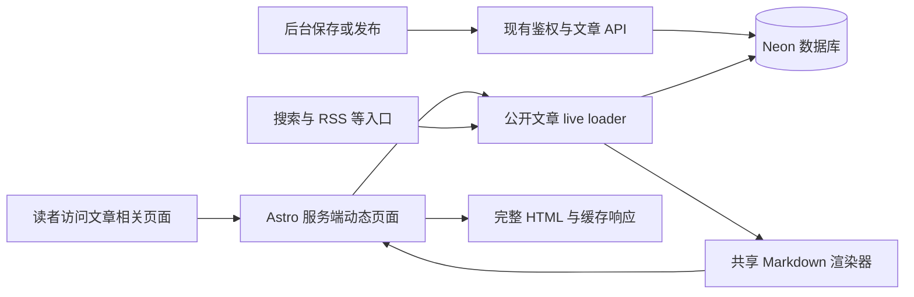

<!-- 想删除本方案：删除本文件，再移除 README 的学习资料链接及可选模块登记。隔离原型和证据位于已忽略的 practice/_dynamic-proof 与 practice/_dynamic-evidence，可独立移除。 -->

# 文章动态发布方案与验证记录

日期：2026-10-24（2026-11-22 同步落地状态）。状态：**正式代码已切换至动态发布，待 Netlify Preview 预览环境实测缓存与真库链路后再合入生产**。

### 正式落地说明（相对原方案的精简）

- 公开读取统一收敛到 `src/lib/publicPosts.ts`（列表查询只取元数据列、单篇才读正文），未在页面里再套一层 `getLiveCollection` / `getLiveEntry`，已移除无人调用的 `src/live.config.ts`，保持单一数据入口。
- 首页、文章列表与分页（`/posts/`、`/posts/page/[page]`）、正文、文章 OG 图、标签、归档、RSS/Atom、动态站点地图（`/sitemap-posts.xml`）及实时搜索（`/search`、`/api/public-search`）均已切换为按需 SSR + 统一公开缓存/503 错误日志。
- 文章增删改查 API 不再触发 Netlify Build Hook（返回值 `rebuild: null`），`POST /api/rebuild` 仅保留作兼容接口。
- 新增的 3 组动态测试（`dynamic:data:test`、`dynamic:discovery:test`、`pagination:test`）已并入 `npm test`。

目标是让文章的发布、修改、下线不再触发一次整站生产部署。代码升级仍需要部署，访问请求、流量、函数运行和数据库仍可能计费，不能把这个目标解释成“全站无限免费”。

## 已确认的现状

| 入口           | 实际代码                                                      | 为什么现在需要构建                                                     |
| -------------- | ------------------------------------------------------------- | ---------------------------------------------------------------------- |
| 首页           | `src/pages/index.astro`                                       | `getCollection("posts")` 读取构建时的文章快照                          |
| 正文           | `src/pages/posts/[...slug]/index.astro`                       | `getStaticPaths()` 枚举已存在的网址，`render(post)` 读取提前渲染的正文 |
| 文章分页       | `src/pages/posts/[...page].astro`                             | `paginate()` 在构建时生成分页地址                                      |
| 标签           | `src/pages/tags/index.astro`、`[tag]/[...page].astro`         | 从同一份快照计算标签和分页                                             |
| 归档、订阅介绍 | `src/pages/archives/index.astro`、`src/pages/rss/index.astro` | 读取构建时文章集合                                                     |
| RSS / Atom     | `src/lib/feed.ts`、两个 XML 路由                              | 默认预渲染，订阅条目也是构建时的                                       |
| 搜索           | `src/pages/search.astro`、`package.json`                      | 构建后运行 Pagefind，索引不会随着数据库保存自动更新                    |
| 文章分享图     | `src/pages/posts/[...slug]/index.png.ts`                      | 静态枚举文章，为每篇生成图片                                           |
| 站点地图       | `astro.config.ts` 的 sitemap 集成                             | 静态路由枚举无法自动覆盖后来发布的文章                                 |
| 后台发布       | `src/pages/api/_routes/posts.ts`、`src/lib/rebuild.ts`        | 发布状态改变后通知 Netlify Build Hook                                  |

**不能只改 `prerender = false`**：构建时的 `getCollection()` 不会因此变成实时查询，原有搜索索引也不会自动更新。

## 推荐结构

继续使用 Astro、Netlify、Neon 和 Better Auth。友链、说说、项目等文件内容继续静态生成；只有依赖文章的页面动态读取。



Astro 7.3.5 已提供 `defineLiveCollection()`、`getLiveCollection()`、`getLiveEntry()` 和 `render()`。与构建集合分开放到 `src/live.config.ts`，可以继续生成完整 HTML，不要求访客浏览器再请求一次正文。参见 [Astro 官方说明](https://docs.astro.build/en/guides/content-collections/#live-content-collections)。

数据入口只提供公开文章，统一执行状态和发布时间判断。后台继续按原权限读取草稿，不复用公开缓存。

## 隔离原型验证结果

临时原型：`practice/_dynamic-proof/`；HTTP 地址绑定 `127.0.0.1:4333`。使用项目现有迁移、文章仓库函数、`toEntryData()` 和 Markdown 配置，数据库是进程内 PGlite，未写入线上数据。

通过 HTTP 修改测试数据库后，同一 Astro 开发服务实例内的 **12 项检查通过**：

1. 草稿不出现在首页和搜索，正文返回 404。
2. 发布后新网址立即可访问，HTML 响应直接包含文章标题和正文。
3. Shiki 高亮、KaTeX 公式、提示块、重复标题锚点及目录链接可以生成。
4. 标签、RSS、Atom 和动态文章网址清单能读取新文章。
5. 修改后列表、正文、标签、订阅和搜索一起变化。
6. 修改 slug 后旧地址返回 404，新地址可以访问。
7. 下线后正文、列表、搜索及订阅同步移除。
8. 删除后正文返回 404。
9. 超出当前发布时间容差的未来文章不会公开。
10. 保留现有 15 分钟发布时间容差：`astro-paper.config.ts` 中的 `scheduledPostMargin`。
11. 数据库故障返回不缓存的 503，不伪装成文章不存在。
12. 数据库恢复后页面恢复，服务实例未重启。

测试过程中没有修改源文件或重新构建。原型关闭 HTML 缓存，因此证明的是实时数据链路，**不证明生产缓存或部署适配已完成**。网址清单原型返回 JSON，不是正式站点地图 XML。搜索原型使用内存查询，不代表生产查询性能。

复验方式（原型文件是临时文件，不进入 Git，重新克隆后不会存在）：

```powershell
# 第一终端，在原型目录启动独立服务
cd practice/_dynamic-proof
npx astro dev

# 第二终端，位于仓库根目录
node practice/_dynamic-proof/verify.mjs
```

结果位于 `practice/_dynamic-evidence/result.json`，测试文章 HTML 位于同目录的 `article.html`。原型中的写接口只用于测试，不能复制到生产路由中。

## 原型暴露的迁移问题

### Markdown 与 Mermaid

直接复用配置中的 Markdown processor 时，高亮、公式和提示块生效，但 Mermaid 输出仍是高亮代码，没有生成 `pre.mermaid`。目前 Mermaid 的转换由集成在构建配置阶段注入，不能假定运行时新建的 renderer 自动继承。

正式改造需要把渲染配置整理为一份共享配置，明确接上 Mermaid 的运行时转换和浏览器初始化；不复制出两套会逐渐分叉的插件列表。必须验证目录、复制代码按钮、重复标题、数学公式、图表切换及文章中的图片。

### 动态路由和分页

`posts/[...page].astro` 与 `posts/[...slug]/index.astro` 都能匹配多段路径。现在依靠构建时的路径清单分开，不能直接原样全部变成动态路由。

建议文章列表使用 `/posts/`，分页使用 `/posts/page/2/`，正文保持 `/posts/文章标识/`。旧数字分页地址确认没有同名文章后跳转到新地址；数字文章标识优先按实际文章匹配，避免把文章误当页码。标签仍使用独立的 `/tags/标签/页码/` 路径。

### 搜索、分享图和站点地图

- Pagefind 不再作为动态文章的搜索数据源。用只读公开搜索接口，限制关键字长度、返回数量和返回字段，参数化查询；保留现有搜索页面外观。原型只验证新文章能被查询，尚未验证正式 SQL 的效率。
- 文章分享图同样需要动态查询；只允许已公开文章，避免草稿信息通过图片泄露。当前中文字体缺字仍是另一条已记录待办。
- RSS、Atom、订阅介绍、归档、标签和站点地图都要接同一个公开数据规则。站点地图的 XML 和索引入口需要一起更新。
- 读不到数据库时响应 503，文章不存在或不公开时才响应 404；这两类响应都不要长期缓存。

## 缓存与成本边界

建议先对公开 HTML 和订阅源设置统一、短期的服务端缓存，候选上限为 30 秒；文章修改最多延迟一个缓存周期。文章下线后缓存仍可能存活到这个上限，不能承诺“立即撤回所有已缓存页面”。后台、草稿、错误响应不缓存。第一次切换时先验证平台实际命中和过期行为，再确定缓存参数。

Markdown 编译缓存应按文章 id 和 `updatedAt` 区分，并限制容量；每次仍先确认文章公开状态，不能只凭旧 HTML 缓存返回已下线文章。跨函数实例不能靠一个进程内变量来保证全站立即失效。

2026-10-24 在本机经代理对真实 Neon **只读**测试三轮：

| 轮次 | 列已发布文章 | 按 slug 查单篇 |
| ---- | ------------ | -------------- |
| 1    | 3408 ms      | 1366 ms        |
| 2    | 369 ms       | 370 ms         |
| 3    | 616 ms       | 345 ms         |

这只是本机网络和当前一篇公开文章的采样，不能当作 Netlify 的线上延迟或压力测试结果。正式列表查询应避免携带全部正文；列表、标签和搜索不能每次为全部文章重新编译 Markdown。

按当前 Netlify 积分制规则，每次成功的生产部署为 15 积分；动态改造可以省去文章发布带来的这项固定开销，但请求、计算和流量仍计费。代码改造首次上线也需要一次生产部署。是否总体更省，取决于发布频率、访问量、函数用量及缓存命中率；尚未核对账户实际套餐及账单。参见 [Netlify 官方计费说明](https://docs.netlify.com/manage/accounts-and-billing/billing/billing-for-credit-based-plans/how-credits-work/)。

## 完整改造顺序与验收条件

| 顺序            | 涉及文件或模块                                                          | 验收条件                                                                                           |
| --------------- | ----------------------------------------------------------------------- | -------------------------------------------------------------------------------------------------- |
| 1. 数据与正文   | `src/live.config.ts`、`src/db/loaders/`、共享 Markdown 渲染器、正文路由 | 复用文章字段定义；仅公开文章可读；正文与图表、目录、复制按钮等功能回归通过                         |
| 2. 所有阅读入口 | 首页、文章分页、标签、归档、订阅页、RSS、Atom、分享图、站点地图         | 新文章不经过构建即可从每个入口访问；旧分页链接有明确兼容行为                                       |
| 3. 搜索         | 搜索页、公开查询接口、语言文件                                          | 新文立即可检索；下线后不再返回；输入输出安全；不依赖过期 Pagefind 索引                             |
| 4. 后台发布     | 文章 API、`src/lib/rebuild.ts`、后台编辑页及文案                        | 文章增删改查不调用 Build Hook；明确区分保存成功、公开状态与缓存更新时间                            |
| 5. 部署验证     | `astro.config.ts`、`package.json`、Netlify 预览                         | 构建不依赖文章快照；SSR 包含所需 Markdown 依赖；预览环境验证缓存、真实 Neon 与认证；再决定生产发布 |

最关键的验收是：**部署一次代码后，创建一篇之前不存在的文章，修改、下线、删除它；整个过程没有新生产部署，各入口按约定时间更新。**

不能在前几步尚未完成时先移除自动重建，否则现有静态页面会一直停留在旧内容。切换时应将动态页面、实时搜索和后台文案作为同一个发布范围。上线后若回退旧静态版本，要同时恢复旧发布流程，并重新构建数据库中的最新内容，避免回退后文章消失。

正式代码改完仍须依次通过 `npm run format:check`、`npx astro check`、`npx eslint .`、`npm run build`，并调整依赖静态 `dist/` 的订阅测试、公开页面浏览器回归和部署验证。

本轮未验证：完整生产 SSR 构建、Netlify 缓存、运行时 Mermaid、真实搜索查询性能、真实发布后的积分变化，以及全部现有页面完成切换后的浏览器回归。当前正式代码仍使用原发布流程。
